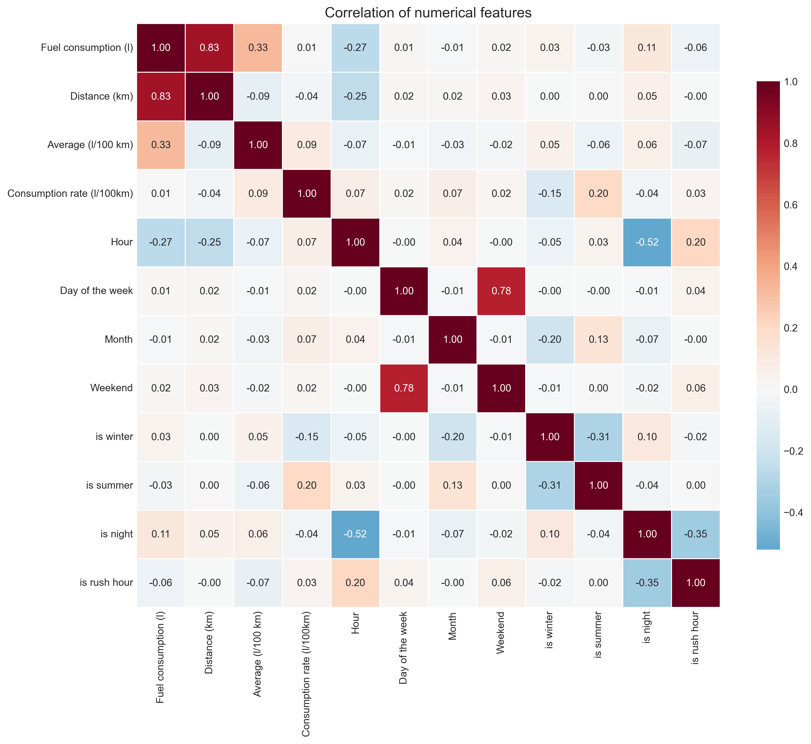

# FRPS — система прогнозирования расхода топлива автобусного парка

## О проекте

FRPS (Fuel Rate Prediction System) — аналитическая система для прогнозирования расхода топлива и оценки будущих затрат по транспортным контрактам.

Проект был разработан на основе операционных данных автобусного парка, включающего более 300 транспортных средств, работающих в семи районах. Для построения модели использовались данные по 200 автобусам.

Основная проблема заключалась в том, что традиционное планирование опиралось преимущественно на фиксированные нормативы расхода топлива. Такие нормативы не всегда учитывают реальные условия эксплуатации: маршрут, расстояние, сезон, время рейса, район обслуживания и особенности конкретного автобуса. Это может приводить к недооценке затрат при подготовке конкурсных заявок.

Цель проекта — разработать data-driven инструмент, который использует исторические данные и методы машинного обучения для более точного планирования расхода топлива.

## Что было сделано

В рамках проекта был реализован полный цикл работы с данными:

- проведена очистка и подготовка истории автобусных рейсов;
- объединены данные о рейсах, автобусах, районах, классах транспортных средств и нормативах расхода топлива;
- выполнен исследовательский анализ данных;
- изучены распределения, выбросы, сезонность и различия между районами;
- построена матрица корреляций числовых показателей;
- созданы дополнительные временные и категориальные признаки;
- обучены и сравнены несколько моделей машинного обучения;
- выполнен подбор гиперпараметров XGBoost;
- сохранены итоговая модель и кодировщики категориальных признаков;
- разработан прототип системы FRPS с пользовательским интерфейсом;
- проведена оценка экономического эффекта от внедрения системы.

В исходной выборке содержалось более 174 тысяч записей о рейсах. После очистки и удаления некорректных наблюдений для моделирования было использовано 70 132 записи.

## Используемые признаки

Для прогнозирования расхода топлива использовались следующие группы признаков:

- расстояние рейса;
- час отправления;
- день недели;
- признак выходного дня;
- месяц и сезон;
- ночное время;
- час пик;
- идентификатор автобуса;
- район обслуживания;
- нормативный расход топлива;
- класс и эксплуатационные характеристики автобуса.

Для корректной передачи циклической природы месяцев в модель были созданы синусное и косинусное представления месяца. Категориальные признаки автобуса и района были преобразованы в числовой формат и сохранены в отдельных кодировщиках.

## Моделирование

В проекте сравнивались различные алгоритмы регрессии:

- Linear Regression;
- Ridge и Lasso;
- Decision Tree;
- Random Forest;
- Gradient Boosting;
- Extra Trees;
- XGBoost;
- LightGBM;
- CatBoost;
- HistGradientBoosting;
- LinearSVR;
- MLPRegressor.

Модели оценивались на единой тестовой выборке. В качестве основной метрики использовалась **MAE**, поскольку она показывает среднюю абсолютную ошибку прогноза непосредственно в литрах на 100 км и легко интерпретируется с точки зрения бизнеса.

Лучшей моделью стал **XGBoost**.

## Основные результаты

На исходных операционных данных компании были получены следующие результаты:

| Метод | MAE |
|---|---:|
| Нормативный метод | 8,00 л/100 км |
| XGBoost | 3,71 л/100 км |

Таким образом, модель машинного обучения обеспечила более точный прогноз расхода топлива по сравнению с использованием фиксированного норматива.

Расчётный экономический эффект от внедрения FRPS составил:

- около **22,39 млн рублей в год**;
- срок окупаемости — около **44 дней**;
- NPV за три года — около **26,4 млн рублей**.

## Результаты на синтетических данных

Из-за требований NDA исходные данные компании не могут быть опубликованы. Поэтому в открытой версии проекта используется синтетический аналог данных.

На опубликованной синтетической выборке XGBoost с подбором гиперпараметров показал:

| Метрика | Результат |
|---|---:|
| MAE | 2,53 л/100 км |
| MAPE | 15,3% |
| R² | 0,801 |
| MAE нормативного метода | 8,14 л/100 км |

Результаты на синтетической выборке отличаются от результатов основной проектной работы, поскольку модель была повторно обучена на искусственно созданных данных.

## Прототип FRPS

Прототип системы реализован с использованием Python и Tkinter.

Пользователь может:

1. добавить транспортный контракт;
2. указать маршруты и их протяжённость;
3. сформировать расписание рейсов;
4. назначить автобусы;
5. выбрать период выполнения контракта;
6. рассчитать прогнозируемый расход топлива;
7. оценить общую стоимость топлива;
8. сравнить прогноз модели с нормативным расчётом;
9. выгрузить подробные и итоговые результаты в CSV.

Система формирует отдельный прогноз для каждого планируемого рейса, после чего агрегирует результаты по автобусам, маршрутам и контракту в целом.

## Конфиденциальность данных

В соответствии с требованиями NDA реальные операционные данные компании не размещаются в открытом доступе.

Для воспроизводимости проекта был создан синтетический набор данных, сохраняющий основные свойства исходной выборки:

- распределение расхода топлива;
- сезонные закономерности;
- различия между районами;
- особенности классов автобусов;
- структуру временных показателей;
- статистические зависимости между переменными.

Идентификаторы автобусов, названия районов и другие конфиденциальные сведения были заменены.

Описание процесса создания синтетических данных и соответствующие CSV-файлы находятся в [отдельном репозитории](https://github.com/huagale/DEVELOPING-THE-FORECAST-SYSTEM-OF-FUEL-CONSUMPTION-FOR-THE-BUS-FLEET-CONSIDERING-ROUTING-NETWORK).

## Содержание репозитория

- `fuel_modelling.ipynb` — основной ноутбук с очисткой данных, исследовательским анализом, созданием признаков, обучением, настройкой и сравнением моделей.

- `frps system.ipynb` — прототип системы FRPS с интерфейсом на Tkinter. Использует сохранённую модель для прогнозирования расхода топлива по контракту.

- `best_model.pkl` — обученная модель XGBoost с подобранными гиперпараметрами. Позволяет выполнять прогнозирование без повторного обучения модели.

- `le_bus.pkl` — кодировщик идентификаторов автобусов, преобразующий категориальные значения в числовой формат.

- `le_rayon.pkl` — кодировщик районов обслуживания.

- `correlation_matrix.png` — визуализация корреляций между числовыми признаками.

- `catboost_info/` — служебная папка, автоматически созданная CatBoost во время обучения. Содержит журналы обучения и историю изменения метрик. Для работы итоговой модели XGBoost не требуется.

- `Palmira fuel forecasting.pdf` — презентация с описанием бизнес-проблемы, анализа данных, результатов моделирования, архитектуры FRPS и экономического эффекта.

- `README.md` — описание проекта, методологии, результатов и структуры репозитория.

## Матрица корреляций

## Используемые технологии

- Python;
- Pandas и NumPy;
- Scikit-learn;
- XGBoost;
- LightGBM;
- CatBoost;
- Matplotlib и Seaborn;
- Tkinter;
- Joblib;
- Jupyter Notebook.

## Материалы проекта

- [Презентация проекта](./Palmira%20fuel%20forecasting.pdf)
- [Репозиторий с синтетическими данными](https://github.com/huagale/DEVELOPING-THE-FORECAST-SYSTEM-OF-FUEL-CONSUMPTION-FOR-THE-BUS-FLEET-CONSIDERING-ROUTING-NETWORK)
